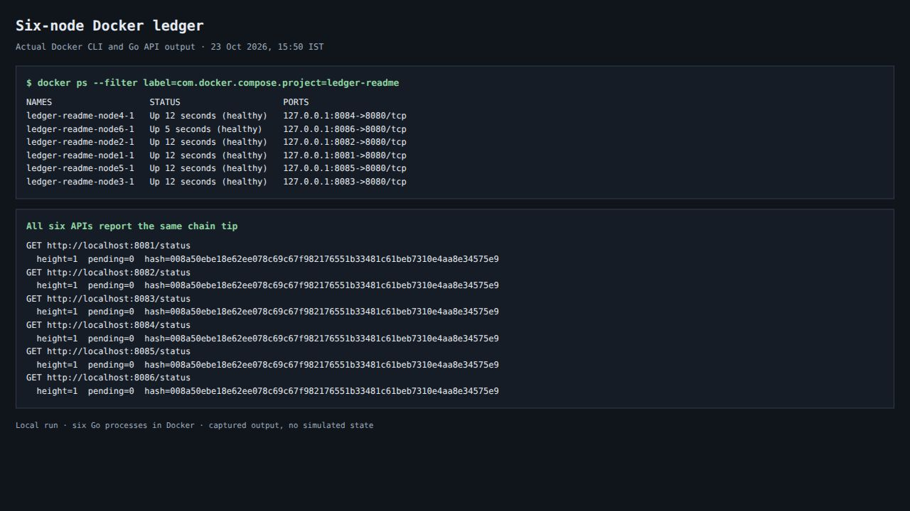
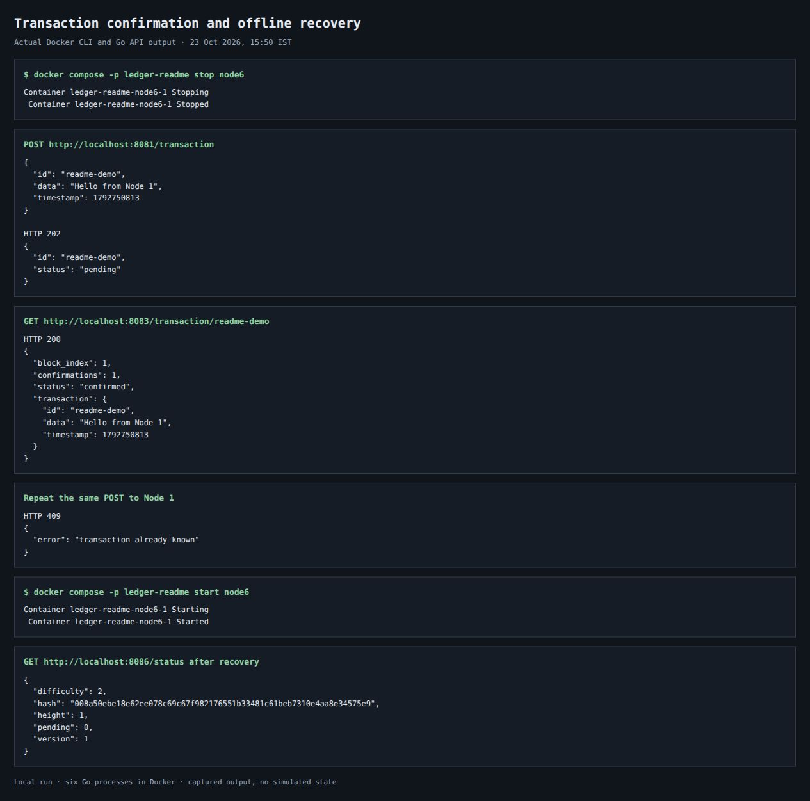

# Distributed P2P Ledger

Six Go nodes gossip messages, mine proof-of-work blocks, and agree on a shared
ledger. Runs locally with Docker Compose. Transactions are messages; there are
no wallets or money transfers.

## Run locally

Requires Docker Engine and Docker Compose.

```bash
git clone https://github.com/dhanunjay1729/Distributed-P2P-Ledger.git
cd Distributed-P2P-Ledger
docker compose up --build -d --wait
```

Nodes listen on `localhost:8081` through `localhost:8086`, each with its own
persistent storage.

Submit a transaction to Node 1:

```bash
curl http://localhost:8081/transaction \
  -H 'Content-Type: application/json' \
  -d "{\"id\":\"demo-1\",\"data\":\"Hello from Node 1\",\"timestamp\":$(date +%s)}"
```

Wait for mining, then check the transaction on Node 3:

```bash
curl http://localhost:8083/transaction/demo-1
curl http://localhost:8083/chain
```

Mining runs every 10 seconds by default. Nodes validate incoming blocks, resolve
forks, and catch up automatically after restarting. Repeated transaction IDs
return `409 Conflict`.

Stop the cluster:

```bash
docker compose down
```

Confirmed blocks survive restarts. Unconfirmed transactions are held in memory.

## Actual implementation

Docker CLI and Go API output captured from a local six-container run.

All six containers are healthy and report the same chain tip:



A transaction submitted to Node 1 is confirmed on Node 3. Node 6 was stopped
during mining and caught up after restarting. Submitting the same ID again is rejected:



## API

| Method | Endpoint | Purpose |
| --- | --- | --- |
| POST | `/transaction` | Submit a message |
| GET | `/transaction/:id` | Pending or confirmed status |
| GET | `/chain` | Full blockchain |
| GET | `/mempool` | Pending messages |
| GET | `/status` | Height, tip hash, difficulty, pending count |
| GET | `/healthz` | Node health |

Peers exchange transactions through `POST /gossip` and blocks through `POST /block`.

## Tests

```bash
make check         # Static checks, race tests, and simulator tests
make smoke         # Six native processes, including offline recovery
make docker-smoke  # Six containers; removes the test cluster afterward
```

[Development notes](docs/DEVELOPMENT.md) cover native setup, configuration, protocol
rules, and limits. Older ID-only chains need a fresh data directory; invalid
existing files are preserved.

[Browser simulator](https://dhanunjay1729.github.io/Distributed-P2P-Ledger/) — a
separate teaching demo.

Started as a collaborative gossip ledger in the
[original project](https://github.com/indrakantisaidharahas/Distributed-P2P-Ledger),
then extended with mining and fork recovery by Dhanunjay Reddy.
